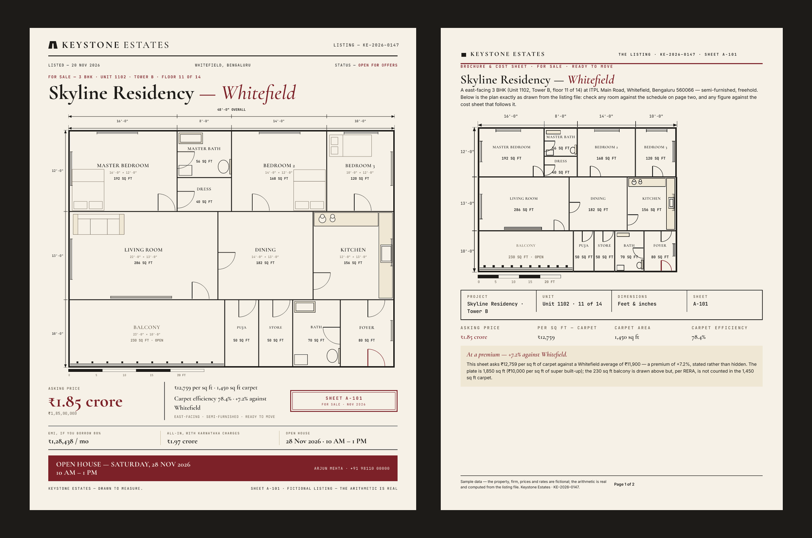
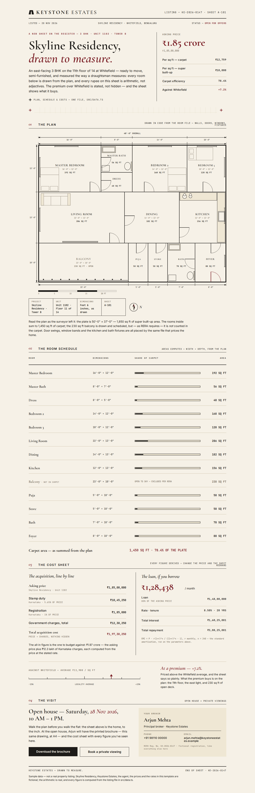

# The Listing — The Real Estate Kit

**Drawn to measure.** A complete real-estate listing kit — new-listing alert,
listing page, brochure & cost sheet, and poster — designed as an architect's
drawing sheet: ivory drafting paper, charcoal ink, one oxblood accent, and a
floor plan drawn in code from the room data. Every figure on every sheet is
arithmetic, not adjectives.



**Live demo:** https://the-listing-real-estate-kit.vercel.app/

## The story

Property listings hide their maths: a headline price, a super built-up area
nobody lives in, charges that surface at registration. The Listing is the
sheet a draughtsman would publish instead. One fictional property —
**Skyline Residency, Tower B, Unit 1102, Whitefield, Bengaluru**: an
east-facing 3 BHK on the 11th floor of 14, asking ₹1.85 crore, ready to move —
is measured, priced and drawn in four formats, and the sheet states its own
premium plainly rather than hiding it.

## One listing file in, everything computed out

All four templates render from a single listing file in `src/data.ts`.
Nothing is typed in by hand:

- **The plan is geometry, not a picture.** Thirteen rooms are defined by
  position and size in feet; they tile a 48 × 35 ft inner plate. Room areas
  are width × depth, computed; the plan's walls, door swings, window bands,
  fixtures, dimension strings and labels all derive from the same room data.
- **Carpet area is a sum, not a claim** — the carpet rooms total **1,450 sq
  ft**; the 230 sq ft balcony is drawn and scheduled but excluded, per RERA.
  Against the 1,850 sq ft plate (50 × 37 ft), **carpet efficiency is 78.4%**.
- **Price per sq ft both ways:** ₹12,759 on carpet, ₹10,000 on super
  built-up — the gap between them is the point.
- **Locality verdict, derived:** against a Whitefield average of ₹11,900 per
  sq ft, the listing sits at **+7.2%**, which crosses the +5% band in code
  and produces the verdict **"At a premium"** — printed on the sheet.
- **Government charges:** Karnataka stamp duty 5.65% (₹10,45,250) +
  registration 1% (₹1,85,000) = ₹12,30,250; **total acquisition ₹1,97,30,250**.
- **The loan, amortised:** 80% of the price at 8.5% over 20 years through
  the standard formula EMI = P·r(1+r)^n / ((1+r)^n − 1) → **₹1,28,438/month**,
  total interest ₹1,60,25,081.

Change the price, a room's width, the duty rate or the loan share in
`src/data.ts` and the plan redraws and every figure re-derives, everywhere.

## The four templates

| Root | Output | What it is |
|---|---|---|
| `Email` (600px) | `out/listing-alert.html` | New-listing alert + open-house invite — masthead, headline, price panel, facts grid, "the plan, in words" (room areas as ruled rows), the computed money, oxblood open-house band, two buttons to the live demo |
| `Page` (1120px) | `out/listing.html` | The listing page — four numbered sections: the code-drawn plan with dimension strings, title block and north arrow; the room schedule with share bars; the cost sheet with loan panel and locality gauge; the visit section with broker card |
| `Document` (A4, 2 pages) | `out/brochure.pdf` | Brochure & cost sheet — plan, key figures and the premium verdict on page 1; page 2 is the room schedule plus "the arithmetic": charges shown as rate × price, the amortised loan in full |
| `Canvas` (1080×1350) | `out/listing-poster.png` | The poster — the drawing sheet itself: the plan as hero, price block with sheet stamp ("Sheet A-101"), measured cost strip, oxblood open-house band |



## How Hyper Elements is used

- All four roots — `Email`, `Page`, `Document`, `Canvas` — from one
  `defineTheme()` and a shared component library (keystone wordmark,
  mastheads, section heads, ruled cost rows, the sheet stamp, the locality
  gauge, and the floor-plan renderer). The Email uses an Svg-free variant
  of the art, since Svg isn't available in email — its plan becomes "the
  plan, in words": the same room data as ruled area rows.
- The floor plan is a composition of `Layer`, layout and `Svg`: room cells'
  borders are the walls, and an Svg overlay per room carries door-swing
  arcs (built from line segments), window bands and drawn fixtures —
  kitchen counters and hob, bath tub, WC and basin, balcony railing.
- `validate()` gates the build; the Document renders via `renderPdf()` and
  the Canvas via `renderImage()`, with real Cormorant Garamond / Inter /
  JetBrains Mono font files passed as bytes.
- The email was checked with `@hyper-elements/email-clients`: **7 client
  previews** (Outlook, Outlook.com, Gmail, Apple Mail, iPhone) are
  generated by the build into `out/email-clients/`.

**Validation: 0 errors, 0 warnings on all four templates** (the email
carries 39 informational notes — classic Outlook letter-spacing,
font-weight, border-radius and button-hover notes — nothing broken, as the
previews show).

## Run it

```bash
npm install
npm run build   # validates, then renders everything into out/
npm run check   # validate only
```

## Design

"The Drawing Sheet." Ivory drafting paper (`#F6F1E7`), parchment panels
(`#EFE7D4`), charcoal ink (`#1D1B18`), hairline rules (`#C9BCA0`) — and ONE
oxblood (`#7C2128`), spent only where a draughtsman's red pencil would
fall: the price, the verdict, the open-house band, the sheet stamp.
Hairline drafting rules, dimension lines with arrowheads and measurement
labels, a north arrow, a plan title block. Cormorant Garamond for display
(its italics carry the sheet's voice), Inter for data, JetBrains Mono only
for dimensions and measurements — because on a drawing sheet, the
measurements *are* the design. No photographs exist anywhere in the kit;
every visual is drawn linework derived from the listing file.

---

The Listing is fictional. Skyline Residency, Keystone Estates, the agent,
the prices and the rates in this template are invented sample data; the
arithmetic is real. Fonts: Cormorant Garamond, Inter, JetBrains Mono
(SIL OFL — see `assets/fonts/README.md`).
